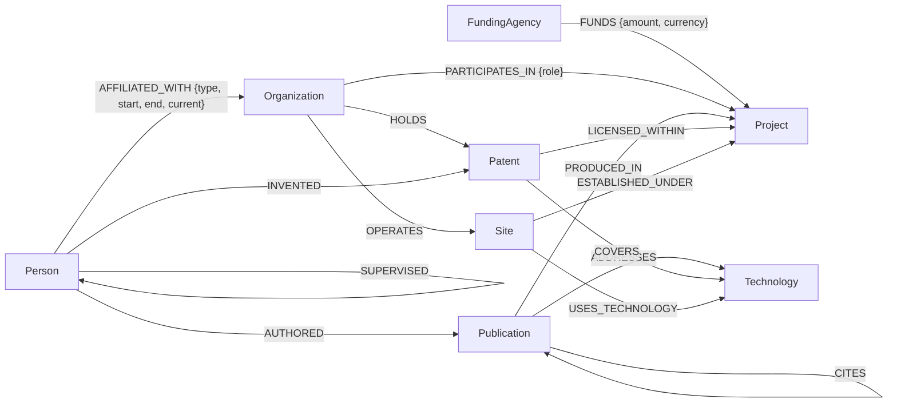
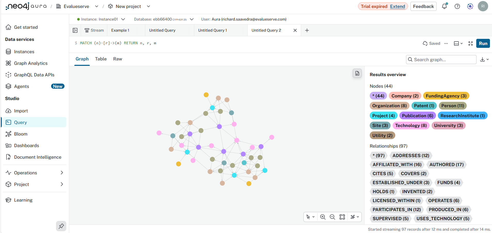

# Energy Research Knowledge Graph (Neo4j Aura)

For this assignment I built a knowledge graph in Neo4j Aura from 35 short documents about an energy-storage research network, then answered the 10 questions in `queries.txt` with Cypher.

The results are in [`results/query_results.csv`](results/query_results.csv) (Question, Cypher Query, Answer, Execution Time). The same results are easier to read in [`results/query_results.md`](results/query_results.md).

## What's in the repo

| Path | What it is |
|---|---|
| `energy_research_corpus/corpus/` | The 35 source documents |
| `queries.txt` | The 10 questions |
| `kg/data.py` | The facts I extracted from the documents. Each node notes the document(s) it came from in `source` |
| `kg/db.py` | Connection to Aura, using the credentials in `.env` |
| `check_connection.py` | Checks the connection and shows how many nodes and relationships are in the database |
| `build_graph.py` | Creates the constraints and loads the graph |
| `cypher/` | One query per question |
| `run_queries.py` | Runs the 10 queries, times them and writes the results |

## How I designed the graph

I started from the questions, not the documents. For each question I asked what it needs to reach in the graph and how to get there in as few hops as possible. I left out everything the questions don't use, so the graph stays easy to read.



Organizations also carry a second label for their type (`:University`, `:ResearchInstitute`, `:Company` or `:Utility`).

| Q | What I needed and how I modelled it |
|---|---|
| 1 | The role in ALPINE is a property of `PARTICIPATES_IN`, so one hop gives each organization and its role |
| 2 | Affiliations have `start` and `end` years, so each author is listed with the organization they belonged to when the paper came out |
| 3 | `SUPERVISED` covers doctoral supervision only. Following it from the earliest supervisor gives the full chain, so Markus Weber is the academic grandparent of Sofia Lindqvist and Tomas Berg |
| 4 | Each affiliation has a `type` (employment, study or visiting). I kept employment and study, as the question asks. `sector` (academia or industry) and `country` on the organization give the direction of each move |
| 5 | `FUNDS` stores the amount as a number with its currency. The `:Company` and `:Utility` labels pick out the industrial partners |
| 6 | I stored `country` on the organization instead of as a separate node, which saves a hop. A researcher's country is the country of their current organization |
| 7 | Following `CITES` any number of steps finds the indirect citations too. The shortest chain tells direct citations from indirect ones |
| 8 | Organizations are connected only through projects, so one collaboration hop is Organization → Project ← Organization |
| 9 | Patent → `COVERS` → Technology ← `USES_TECHNOLOGY` ← Site, following the wording of the question |
| 10 | `ADDRESSES` links each paper to its technology areas. I didn't store co-authorship as its own relationship: two researchers are co-authors if they share a publication |

I extracted the facts by hand rather than with an automatic tool. With 35 short documents this was more reliable, and I could check every value against its source.

## Running it

```powershell
python -m venv .venv
.\.venv\Scripts\pip install -r requirements.txt
copy .env.example .env      # add your Aura credentials

.\.venv\Scripts\python check_connection.py
.\.venv\Scripts\python build_graph.py --reset
.\.venv\Scripts\python run_queries.py
```

## Checking the graph in Aura

In the Aura console, open the instance and go to **Query**. This shows the whole graph:

```cypher
MATCH (n)-[r]->(m) RETURN n, r, m
```



Any file in `cypher/` can be pasted in the same way to see that question's answer.

## About the execution time

The time in the CSV is measured from Python and covers the whole round trip: sending the query, running it and receiving the results. Most of it is network latency to Aura. When `run_queries.py` runs, it also prints the time Neo4j itself reports.
